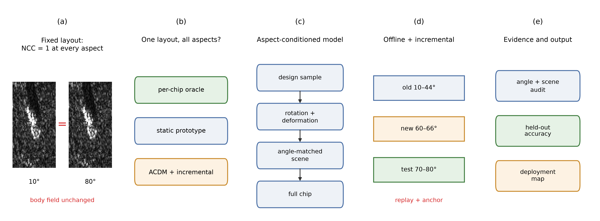
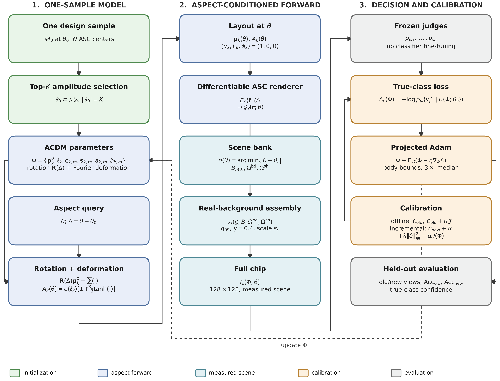
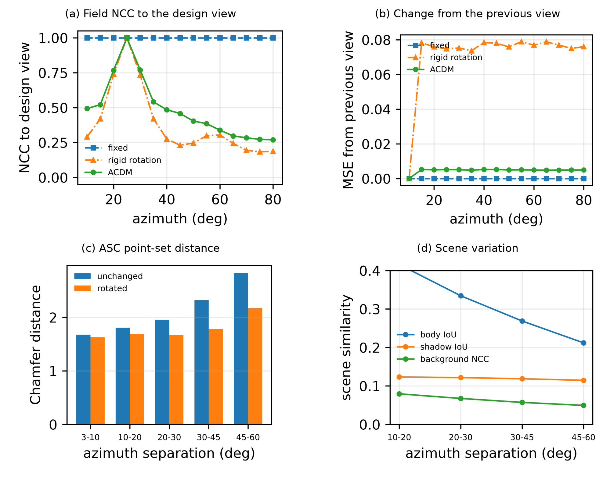
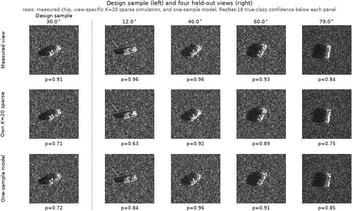
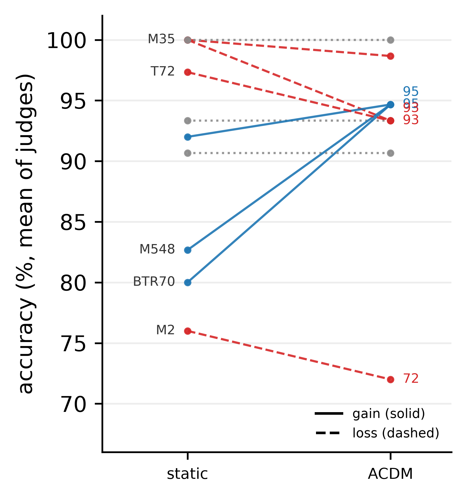
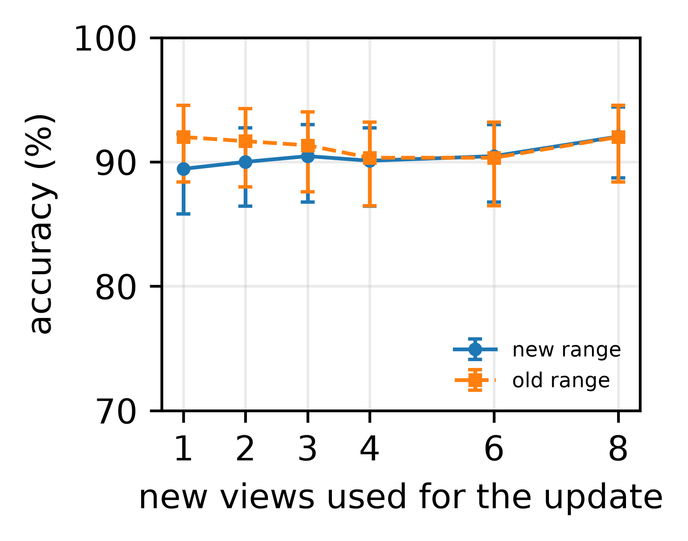
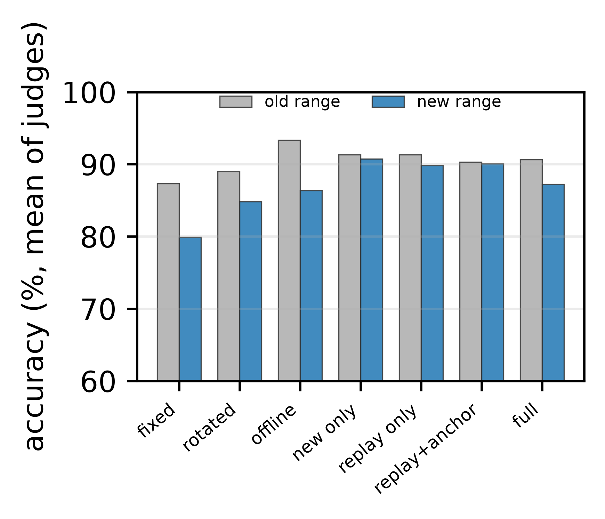

# Aspect-Conditioned Sparse Reflector Models — Aggregated Results

This repository summarizes **aggregated results** from an experimental study on
aspect-conditioned sparse reflector models for SAR target emulation. It contains
figures and summary tables only. **No code, raw data, per-chip records, model
weights, or training assets are included.**

The central question is whether a sparse physical layout can preserve a target's
true class across aspect without being re-fit per view, and whether a model
initialized from one measured sample can replace a view-specific sparse
simulation.

## Method at a glance

- **Sparse forward model.** A target is described by attributed scattering
  centers (position, amplitude, frequency exponent, length, orientation). The
  body is rendered by a differentiable Potter--Moses forward model with a
  two-dimensional Taylor window and a zero-padded inverse FFT.
- **Measured-scene assembly.** The rendered body is inserted into the measured
  background and shadow of the nearest scene at the query azimuth.
- **One-sample aspect-conditioned model (ACDM).** One design sample supplies the
  initial layout. The layout is rotated in the ground plane and modulated by a
  low-order Fourier deformation in position and amplitude.
- **Offline calibration.** The ACDM is fitted on a set of old views with a
  true-class cross-entropy objective and a deformation penalty.
- **Incremental calibration.** A few views from a new aspect band update the
  same physical parameters with a replay buffer and a weighted quadratic anchor.

## Key results

Main split: train on 20 views at 10°–44°, test on 25 disjoint views at 45°–84°.
Accuracy is held-out true-class accuracy; the mean is over the three judges.

| Method | ResNet-18 | EfficientNet-B0 | ViT-B/16 | Mean |
|---|---:|---:|---:|---:|
| ACDM (one-sample init + offline calibration) | 91.2 | 88.4 | 98.0 | **92.5** |
| Static class-shared prototype | 90.4 | 88.8 | 94.4 | 91.2 |
| One-sample rigid rotation (no offline calibration) | 75.6 | 80.4 | 89.6 | 81.9 |
| View-specific top-20 amplitude sparse reference | 94.4 | 94.0 | 97.6 | 95.3 |

The ACDM is **2.8 points** below a view-specific top-20 sparse reference in the
judge mean. This is the cost of using one aspect-conditioned layout instead of a
layout fitted to every view; the reference requires a measured sample at every
view, whereas the ACDM is a deployable object.

Incremental protocol: offline 10°–36°, four new views at 60°–66°, held-out old
range 10°–36°, held-out new range 70°–80°.

| Variant | Old | New | View-steps |
|---|---:|---:|---:|
| ACDM offline | 93.3 | 86.4 | 2000 |
| New-only update | 91.3 | 90.7 | 240 |
| Replay-only update | 91.3 | 89.8 | 480 |
| Replay + anchor | 90.3 | 90.1 | 480 |
| Full retrain on old + new | 90.7 | 87.2 | 2400 |

Four new views raise the new-band mean from 86.4% to 90.1% while the old range
stays at 90.3%. Full retraining reaches 87.2% at five times the view-steps. One
new view already recovers most of the gain.

## Figures

### Overview

Angle-invariant bias, one-sample model, calibration, and evaluation workflow.

### Method pipeline

One-sample initialization, aspect-conditioned rendering, measured-scene
assembly, and the offline/incremental calibration loop.

### Angle and scene audit

(a) Field NCC to the design view; (b) change from the previous view;
(c) ASC point-set distance; (d) measured-scene variation. The fixed field is
angle-invariant (NCC = 1 at every azimuth), while the rotated and ACDM fields
vary with aspect.

### One-sample versus view-specific sparse simulation

One BTR70 design sample at 30.0°. Columns: design sample and four held-out
views. Rows: measured chip, the view's own top-20 amplitude sparse
reconstruction, and the calibrated one-sample model. The number below each panel
is the true-class probability of ResNet-18.

### Per-class reallocation

Per-class accuracy change from the static prototype to the ACDM.

### Incremental calibration

New-band and old-band accuracy as a function of the number of new views.

Comparison of incremental update variants.

## Detailed result tables

- [Main comparison](results/main_comparison.md)
- [Per-chip oracle](results/per_chip.md)
- [Static class-shared prototype](results/static_prototype.md)
- [ACDM versus static prototype](results/acdm_vs_static.md)
- [Incremental calibration and ablations](results/incremental.md)
- [Angle and scene audit](results/angle_audit.md)
- [Scene ablation](results/scene_ablation.md)

## Scope and limitations

- The SAMPLE all-split contains one physical target per class. The reported
  class-shared and incremental claims are **cross-view**, not cross-instance.
- The study covers the 14°–17° elevation band.
- The ACDM is a ground-plane two-dimensional model and does not represent 3D
  layover or elevation-dependent visibility.
- The layout uses trihedral attributes and does not model distributed
  scattering, mutual coupling, or polarization.
- Background and shadow are nearest-neighbour measured scenes, not outputs of
  the scattering-center model.
- The per-chip arm is an oracle upper bound, not a deployable protocol.
- No hardware measurement is reported; the layouts are digital designs.

## What is not included

- No source code.
- No raw SAR data, ASC extractions, or per-chip records.
- No model weights or training assets.

This repository is intended as a compact, human-readable summary of the
aggregated results.

## Acknowledgement

The source codes of this article will be available at
<https://github.com/pzl936/aspect-sparse-results>, contributing to SAR target
recognition and target emulation.
